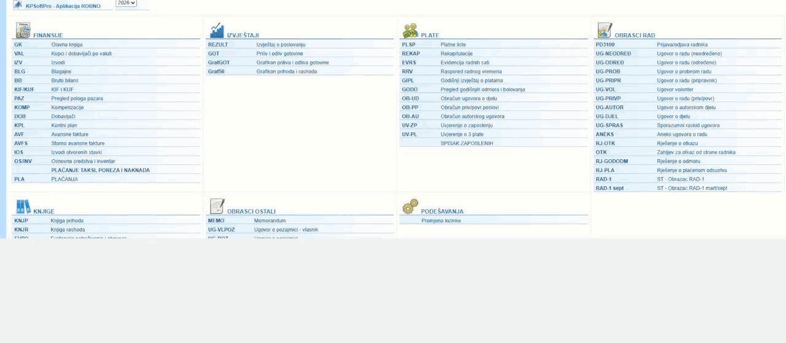
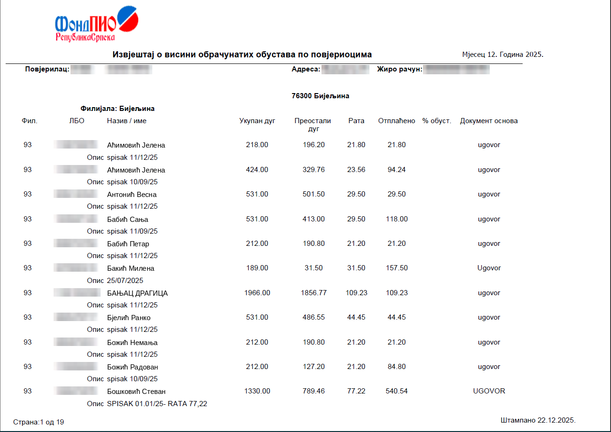
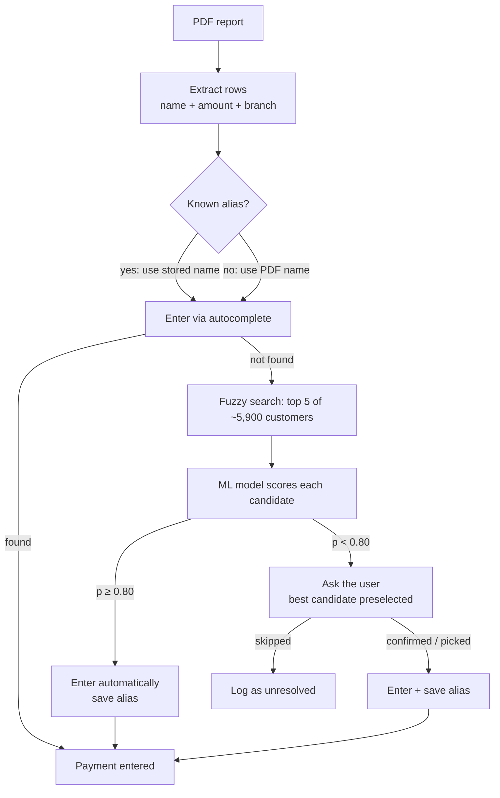
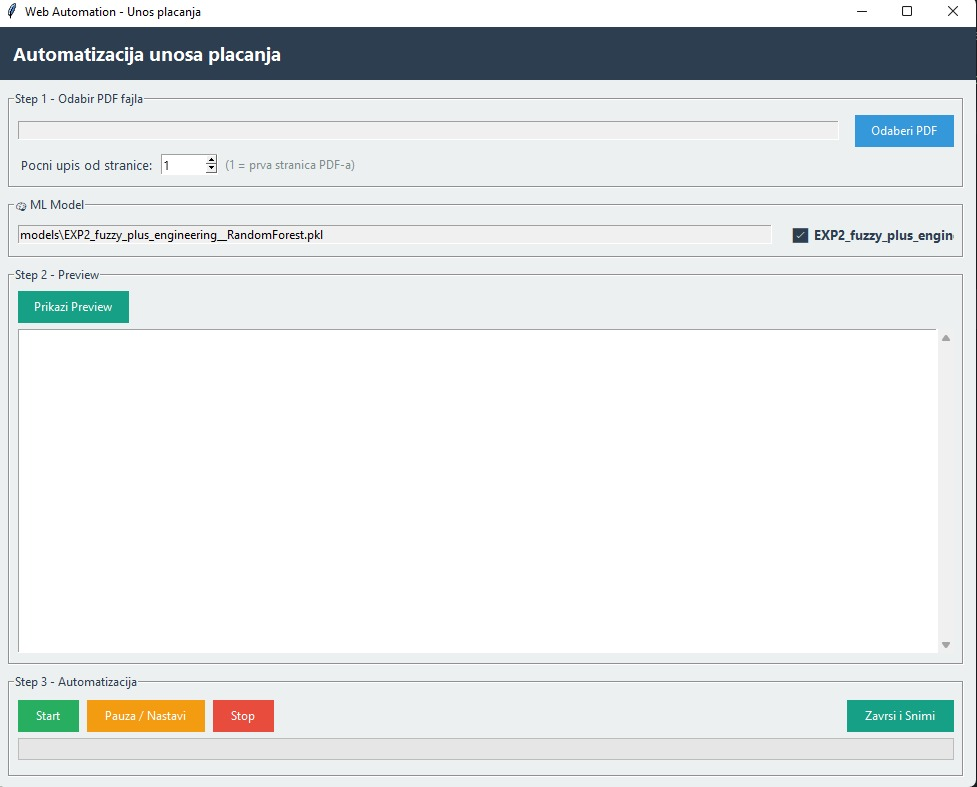
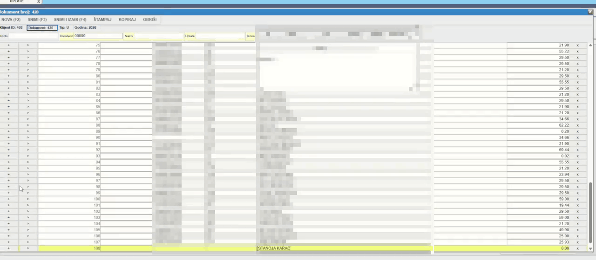
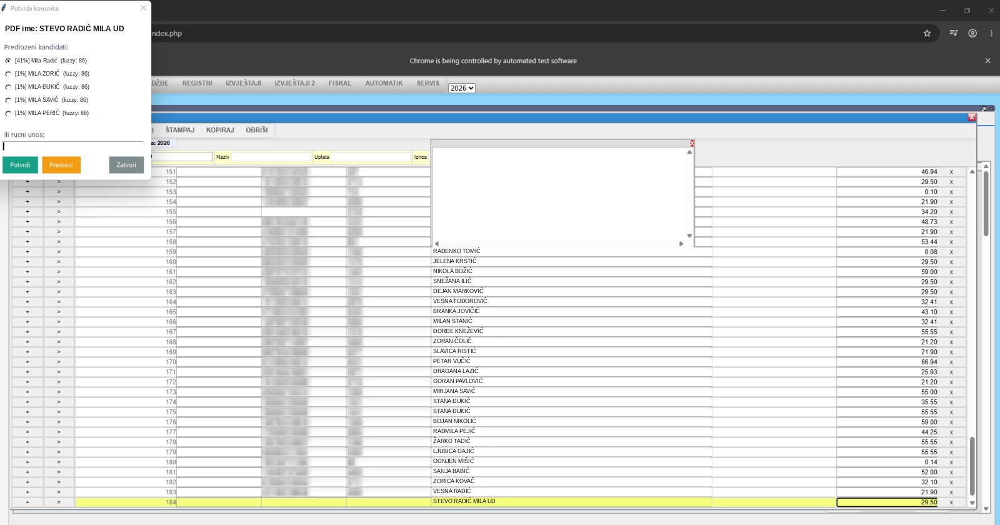
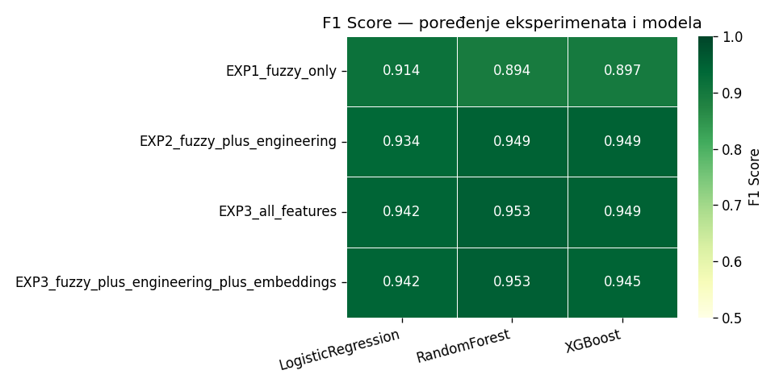

# Automated Payment Entry with ML Name Matching

**Case study:** a desktop tool that reads payment lists from PDF reports and enters them into a client's web-based accounting system. When a name in the PDF doesn't match the customer database (typos, swapped first/last name, missing diacritics), it finds the right customer itself. It enters the payment automatically when it is confident, and asks a human when it isn't.

> Built for one company and tailored to its PDF layout and web application, so it won't run outside that environment. The repository is shared as a case study. It contains **no client data**: in all examples and screenshots the names are fictional, and ID numbers and client details are blurred.



*The bot logs in, opens a new payment document and enters payments row by row (sped up 1.5×). Only the name in the row being filled (yellow) is visible; ID numbers, customer codes, other names and the client's business data are blurred.*

---

## Impact

| | Before | After |
|---|---|---|
| Monthly data entry | ~80 h of manual typing | ~3 h of automated entry |
| Human work | every row | only the uncertain matches |

Each month the company receives PDF reports with hundreds of payments each, and every payment had to be typed into the accounting system by hand. The tool now enters them in one run and stops only for names it can't match with confidence.

---

## The problem: names don't match

The name in the PDF and the name in the accounting system are often written differently. If the bot types the PDF name as-is, the system's autocomplete finds nothing.

Examples of the patterns found in real data (names are fictional):

| PDF | Accounting system | Pattern |
|---|---|---|
| `Marko Ilić` | `ILIĆ MARKO` | first and last name swapped |
| `Jovanka Petrovć` | `JOVANKA PETROVIĆ` | typo |
| `Djordje Savic` | `ĐORĐE SAVIĆ` | missing diacritics / `Dj` instead of `Đ` |
| `STEVO RADIĆ MILENA UD` | `MILENA RADIĆ` | widow format: husband's name + surname + her name + "UD" |
| `Dragana Kostić` | `DRAGANA KOSTIĆ UPL.` | suffix in the system |
| `Nada Lukić` | `NADA MARKOVIĆ` | different surname, only a human can resolve it |

**What the input looks like:** a monthly PDF report with one row per payment. Names are in Cyrillic and in mixed case, and the same person can appear several times (one row per contract). The bot reads the name, the installment (*Рата*) and the branch from the header.



---

## How it works



The desktop app: pick a PDF, optionally start from a given page, preview the extracted rows, then start, pause or stop the run.



1. **PDF extraction.** `pdfplumber` reads names and amounts by their coordinates on the page. It also reads the branch from the header and transliterates Cyrillic to Latin. An OCR fallback for scanned PDFs (LandingAI) is in `src/ocr_processor.py`.
2. **Alias memory.** Every resolved mismatch is stored in SQLite (`PDF name → system name`), so the same name goes straight through next month. Over time most names are resolved this way.
3. **Direct entry.** A Selenium bot logs in, opens the payment table and types the name. If the system's autocomplete finds it, the row is done.
4. **Candidate search.** If not, `rapidfuzz` compares the normalized name (uppercase, no diacritics, no legal prefixes) against the scraped customer list and takes the top 5:
   - ranked by WRatio, ties broken by `token_set_ratio` and then `ratio`;
   - if there is no near-exact match (WRatio < 97), customers from the PDF's branch get a +5 bonus. The branch is a preference, not a filter, so the right person from another branch can still be found.
5. **Decision.** A Random Forest scores each candidate on 13 features: five fuzzy scores, length and token-count differences, Jaccard overlap, first-token similarity, fuzzy token overlap, Jaro-Winkler and the candidate's rank. If the best candidate scores ≥ 0.80, the bot enters it on its own. Otherwise a dialog shows the candidates with their scores, and the user confirms, picks another, types a name or skips.
6. **Feedback loop.** Every decision is saved as an alias with its source (`ml_auto`, `ml_confirmed`, `manual`), which also becomes labeled data for the model.

**Fixing a mismatch without asking.** The PDF says `UD KARLICA ZDRAVKA` (widow format). The bot types it, the system's autocomplete finds nothing, so it searches the customer list. The model is confident (> 0.80) that the customer is `ZDRAVKA KARLICA`, so the bot clears the field, types the corrected name, picks it from the autocomplete and enters the amount. The new alias is saved, and next month this name goes straight through.



**When the model isn't sure.** For `STEVO RADIĆ MILA UD` (widow format) every candidate gets the same fuzzy score (86), so fuzzy matching alone can't choose. The model ranks `Mila Radić` first, but at 41% it's below the 0.80 threshold, so the bot pauses and asks. The best candidate is preselected, and the user confirms, picks another, types a name or skips. The row being filled is highlighted in yellow in the web app behind the dialog.



---

## The ML part

### Data

There was no labeled data at the start. I labeled **116 name pairs** by hand (PDF name → correct customer). From each pair `src/ml/dataset_builder.py` builds a training group:

- **positive:** the correct candidate;
- **easy negatives:** other candidates from the fuzzy top 3;
- **hard negatives:** candidates ranked 4–10 with WRatio > 75, similar but wrong;
- **random negative:** one random customer from the same branch.

Result: **503 rows** (116 positive, 387 negative).

### Experiments

Three feature sets × three models, 5-fold stratified cross-validation, tracked in MLflow (`src/ml/trainer.py`):

| Experiment | Features | LogReg F1 | Random Forest F1 | XGBoost F1 |
|---|---|---|---|---|
| EXP1 | fuzzy scores only | 0.914 | 0.894 | 0.897 |
| EXP2 | + engineered features | 0.934 | 0.949 | 0.949 |
| EXP3 | + multilingual sentence embeddings | 0.942 | 0.953 | 0.949 |



- The engineered features help: +2 pp F1 for Logistic Regression, +5 pp for the tree models.
- Embeddings (`paraphrase-multilingual-MiniLM-L12-v2`) add at most 0.8 pp, and only **+0.4 pp for the best model**. That isn't worth the extra dependency and latency, so **production uses EXP2 Random Forest without embeddings**.

### What a baseline showed

Later I compared the model with the simplest possible approach, always taking the fuzzy top-1 (`scripts/baseline.py`). On the same 116 groups:

| | Correct at rank 1 |
|---|---|
| Fuzzy top-1 (no ML) | 113 / 116 |
| Random Forest (EXP2, production) | 113 / 116 |
| Logistic Regression (EXP2) | 115 / 116 |

**In ranking, the model doesn't beat plain fuzzy matching.** Its real value is the confidence score, which decides when it's safe to enter automatically and when to ask. Fuzzy scores alone don't give that: a wrong candidate can easily score 96/100.

The dataset also covered only cases where the correct customer was already in the fuzzy top 3. So the real bottleneck turned out to be elsewhere.

### The real bottleneck: candidate search

On **172 human-confirmed aliases**, the correct customer was in the top 5 only **144 times (84%)**. Investigating the 28 misses showed:

| Cause | Cases | Fix |
|---|---|---|
| Customer missing from the local list: the scraper had a fixed limit of 43 pages (4,300 customers), while the full list has 60 pages (5,946) | 16 | scrape until the last page; replace the table instead of appending |
| Many candidates with an identical score (85.5), so the correct one landed at random rank 14–41 | 7 | tie-break on secondary fuzzy scores |
| Completely different surname | 5 | none (left to the human) |

After the fixes the correct customer is in the top 5 in **162 of 167** cases. The other 5 aliases pointed to customers that had since been renamed in the system. The remaining 5 misses are different-surname cases that only a human can resolve.

I also tested a dedicated rule for the widow format. It improved results less than the tie-break did and added nothing on top of it, so I didn't use it.

### Other findings

- **Labeling errors.** When the model confidently disagreed with my labels, in three cases the model was right and my label was wrong. Those labels were corrected.
- **Branch mapping.** Assigning customers to branches by place name was wrong for **18%** of customers: unknown places silently went to one default branch. I rewrote it with whole-word matching, fuzzy correction of typos in place names (`BQANJA LUKA` → Banja Luka) and an explicit "Unknown" category.
- **Branch bonus.** In a simulation the bonus raised top-1 from 145 to 150 of 162 without breaking any correct match. The simulation assumes the branch is always known, so this is an upper bound. Each new alias now stores its branch so the effect can be measured on real data.

---

## Limitations

- **Small, hand-labeled dataset** (116 pairs to train). The differences between models are a few examples, so they are indicative, not conclusive.
- **Client-specific.** The PDF coordinates, CSS selectors and branch list are tailored to one company.
- **Human in the loop by design.** A wrong automatic entry is a payment booked to the wrong person, so the threshold favors asking over guessing.

---

## Tech stack

Python · pdfplumber · rapidfuzz · jellyfish · scikit-learn · XGBoost · sentence-transformers (experiment only) · MLflow · SQLite · Selenium · Tkinter · pytest

## Project structure

```
automation_app.py          Tkinter GUI: preview, start / pause / stop, confirmation dialog
src/
  pdf_processor.py         coordinate-based PDF extraction, branch from header, transliteration
  ocr_processor.py         OCR fallback for scanned PDFs (LandingAI)
  document_router.py       picks coordinate extraction or OCR
  fuzzy_matcher.py         normalization, candidate search, tie-break, branch bonus
  web_bot.py               Selenium: login, navigation, entry, retry, save
  database.py              SQLite: aliases, customers, unresolved names, run log
  ml/
    dataset_builder.py     training data with easy / hard / random negatives
    feature_extractor.py   13 pairwise similarity features (+ optional embeddings)
    trainer.py             3 experiments × 3 models, CV, MLflow, plots
  notebooks/               metrics and error analysis
scripts/
  customers_scraper.py     scrape the customer list from the web app
  explore_customers.py     map place names to branches
  load_customers_to_db.py  load customers into SQLite
  baseline.py              fuzzy-only baseline vs. model
tests/                     pytest
artifacts/                 experiment plots and reports
```
